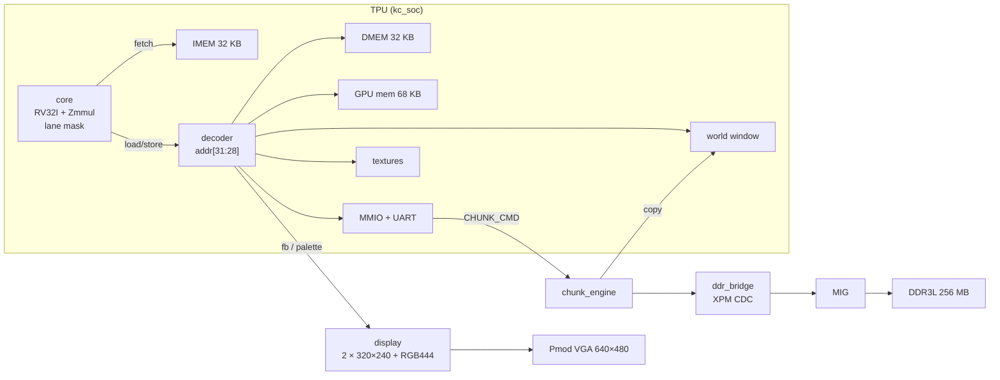

# KennyCraft

A voxel Minecraft running on a custom SoC called the **TPU (Tai Processing Unit)**, built for a single Digilent Arty A7-100T FPGA. HackUTD 2026.

The TPU combines the CPU and the GPU in one chip. It starts from a multi-cycle RV32I core and grows into an 8-lane SIMD GPU. The same core fetches instructions, runs the game, and drives the lanes. Around the core, the TPU adds a byte-addressed framebuffer with VGA scan-out, a palette, a UART, MMIO, and a DDR3 chunk store that streams the world in and out of an on-chip window.

Everything below is grounded in the files in this repo. Where a README and the code disagree, the code wins. The ISA and memory-map contract lives in [`rtl/kc_isa_pkg.sv`](rtl/kc_isa_pkg.sv).

## Status

| Piece | State | Where |
| --- | --- | --- |
| TPU core: RV32I + Zmmul + custom-0 lane control | Done at `LANES=1` (`core.sv` rejects other widths) | `rtl/core/` |
| TPU SoC fabric: decoder, MMIO, UART, 32 KB IMEM/DMEM, 68 KB GPU memory | Done | `rtl/soc/`, `rtl/mem/` |
| Display: double-buffered 320×240 framebuffer, RGB444 palette, 640×480 VGA | Done, own bitstream | `rtl/display/`, `fpga/display_test/` |
| DDR3 chunk store: MIG, CDC bridge, chunk copy engine, scrolling world window | Done, own bitstream | `rtl/ddr/`, `fpga/ddr_test/` |
| 8 lanes, ray unit (custom-1 `VSET`/`VTRACE`/`VGET`), divergence stack (custom-2) | Encodings frozen; hardware not built yet (decodes as illegal) | `rtl/kc_isa_pkg.sv` |
| Board top that combines core, display and DDR3 (P3) | Not yet: `rtl/top.sv` is an interim hello-world wrapper | `rtl/top.sv` |
| Game engine (ray tracer + tile rasterizer) | Runs on the laptop; chip builds link and pass lint | `game/` |

## The TPU



- **Execution.** Multi-cycle FSM with no pipeline: `IF → ID → EX → [MUL | MEM] → WB`. `tb-core-t_cpi` pins the CPI: 4 cycles for ALU, branch, jump, store, `FENCE` and lane control; 5 for `MUL*` and loads from DMEM or MMIO; 8 for a word load from a byte-wide region (world, textures); 7 for a word store to one. `rtl/display/clk_gen.sv` provides the 50 MHz target clock, but the interim board top runs at 100 MHz.
- **ISA.** RV32I plus Zmmul (`MUL`/`MULH`/`MULHSU`/`MULHU` on one registered 33×33 multiply). There is no `DIV`/`REM`, no CSRs, no `ECALL`/`EBREAK`, and no compressed instructions. Custom-0 (`0x0B`) adds lane control: `LANEID`, `LMASK`, `BALLOT`, `MASKGET`, `MASKSET`, `MASKALL`. `is_illegal()` in `kc_isa_pkg.sv` is a whitelist, so any word it does not list is illegal.
- **Errors.** An illegal instruction, a misaligned access, or a fetch outside IMEM halts the core. The fault sets `ERR.ILLEGAL`, latches `ERR_PC`, and lights the error LED. Only reset recovers.
- **Lanes.** The lane mask and every per-lane module keep a `LANES` parameter. Stage 0 elaborates only `LANES=1`.

### Memory map

The region is selected by `addr[31:28]`. Unmapped regions read 0 and drop stores without raising an error.

| Base | Region | Size | Notes |
| --- | --- | --- | --- |
| `0x0000_0000` | IMEM | 32 KB | Fetch only; reset vector 0 |
| `0x1000_0000` | DMEM | 32 KB | Word access with byte enables |
| `0x2000_0000` | World | 128 K blocks × 4 bit | 64×64×32 window; byte access |
| `0x3000_0000` | Textures | 16 K × 4 bit | 16 types × 3 faces × 16×16 texels |
| `0x4000_0000` | Framebuffer | 76,800 B | Back buffer, `row*320 + col` |
| `0x5000_0000` | MMIO | Registers at `0x00`–`0x3C` | See below |
| `0x6000_0000` | Palette | 256 × 12 bit | Write only, one RGB444 entry per word |
| `0x7000_0000` | GPU memory | 68 KB | Mesh pages and command lists for the tile rasterizer |

| MMIO offset | Register | Offset | Register |
| --- | --- | --- | --- |
| `0x00` | `FB_SWAP` (W: request, R: pending) | `0x20` | `ERR_PC` |
| `0x04` | `FRAME_COUNT` | `0x24` | `LEDS` |
| `0x08` | `VSYNC` | `0x28` | `FB_MODE` (0: 320×240 at 2×, 1: 160×120 at 4×) |
| `0x0C` | `CYCLES` | `0x2C` | `DDR_STATUS` (calib, busy, queue full) |
| `0x10` | `UART_RX` (read pops) | `0x30` | `CHUNK_CMD` (stalls the core when the queue is full) |
| `0x14` | `UART_STATUS` (RX avail, TX busy) | `0x34` | `CHUNK_DONE` |
| `0x18` | `UART_TX` | `0x38` | `SLOT_VALID` |
| `0x1C` | `ERR` (write 1 to clear) | `0x3C` | `WIN_ORIGIN` |

These values are defined in `rtl/kc_isa_pkg.sv`, and the game mirrors them in `game/src/kc_hal.h`. The decoder lives in `rtl/soc/decoder.sv` and the registers in `rtl/soc/mmio.sv`. Offsets `0x2C`–`0x3C` are forwarded to `rtl/ddr/chunk_engine.sv`.

## Repository layout

| Path | Contents |
| --- | --- |
| [`rtl/`](rtl) | TPU SystemVerilog. `kc_isa_pkg.sv` holds the frozen encodings, ERR bits, memory map and MMIO offsets. `isa_decode_check.sv` is the decode probe for the ISA tests. `top.sv` is the interim board wrapper. |
| [`rtl/core/`](rtl/core) | Multi-cycle core: FSM (`core.sv`), decoder, ALU, add/sub, barrel shifter, Zmmul `mul`, LSU, immediate generator, LUT-RAM register file |
| [`rtl/soc/`](rtl/soc) | `kc_soc` (the TPU top), address decoder, byte bridge for byte-wide regions, MMIO, 1 Mbaud 8N1 UART with a 16-byte RX FIFO |
| [`rtl/mem/`](rtl/mem) | `memory_arr`: block RAM with byte enables and `$readmemh` init |
| [`rtl/display/`](rtl/display) | `clk_gen` (100 → 50 MHz core / 25 MHz pixel), VGA timing, banked dual-clock framebuffer, palette, swap and CDC logic |
| [`rtl/ddr/`](rtl/ddr) | `ddr_clk`, `ddr_bridge` (XPM async FIFOs), `chunk_engine`, `world_remap` (ring-buffer window), `ddr_model` (MIG stand-in for simulation), MIG project and generation script in `mig/` |
| [`tb/`](tb) | Verilator testbenches by area (`core`, `ddr`, `display`, `isa`). Each `tb/<area>/tb.mk` registers its targets with `make check`. |
| [`sw/tests/`](sw/tests), [`scripts/`](scripts) | `encoding.S` and `check_encoding.py`: assemble every custom-instruction encoding and compare the words against the table in the script |
| [`fpga/`](fpga) | `arty.xdc`, `build.tcl` (non-project Vivado flow), and per-target `sources.tcl` for `top`, `display_test` and `ddr_test`. `ref/` holds the Digilent reference XDCs. |
| [`build/`](build) | fpga-tools MCP entry (`build.tcl`) and `summarize.py`, which turns Vivado reports into `summary.json` |
| [`game/`](game) | KennyCraft itself: a C engine that builds for both the laptop and the TPU. See [`game/README.md`](game/README.md). |
| [`prompts/`](prompts) | Stage agent prompts: P0 ISA package, P1 display, P2 Stage 0 core, P2b DDR3 chunk store |
| `tight_setup_hold_pins.txt` | Saved Vivado list of tight setup/hold endpoints in the DDR bridge CDC. It may be out of date, so regenerate it before relying on it. |

## Getting started

### Prerequisites

| Tool | Used by |
| --- | --- |
| Verilator 5.x (developed on 5.020) | `make check` |
| RISC-V GNU toolchain (`riscv64-unknown-elf-*`) | Core test programs, `tb-isa-asm` |
| Python 3 | Hex conversion, encoding check, `build/summarize.py`, game asset generation |
| Vivado (Artix-7, MIG 7-series) | Bitstreams only |
| C11 compiler; clang with riscv32 + LLVM binutils | `game/` laptop and chip builds |

`RISCV_PREFIX` defaults to a path on the author's machine (`tb/core/tb.mk`). Point it at your own toolchain:

```sh
make check RISCV_PREFIX=riscv64-unknown-elf-
```

### Simulate and lint

```sh
make check                              # all 19 registered testbench + lint targets
make tb-core-t_cpi PLUSARGS=+trace      # one target, with a retirement trace
make clean                              # remove obj_dir/
```

| Area | Targets | Covers |
| --- | --- | --- |
| core | `tb-core-datapath_tb`, `tb-core-program_mem_tb`, `tb-core-t_zmmul`, `tb-core-t_uart`, `tb-core-t_illegal`, `tb-core-t_mmio`, `tb-core-t_lanectl`, `tb-core-t_cpi`, `lint-core` | Datapath, hello-world over UART, Zmmul against a 64-bit reference, RX FIFO, 21 illegal cases, full MMIO map, lane control, exact CPI per instruction class |
| ddr | `tb-ddr-t_chunk_roundtrip`, `tb-ddr-t_slot_valid`, `tb-ddr-t_ring`, `tb-ddr-t_ddr_test`, `lint-ddr` | LOAD/STORE round trips, queue stall, VTRACE priority, slot gating, window scrolling, the `ddr_test` bitstream against `ddr_model` |
| display | `tb-display-display_tb`, `lint-display` | Pixel-exact frames in both `FB_MODE`s, captured from the VGA pins to PPM; swap only at vblank |
| isa | `tb-isa-encoding`, `tb-isa-asm`, `lint-isa` | Every custom encoding row, named illegal and legal cases, and an exhaustive sweep of 1.5 M encodings; assembler output matches the table |

`make check` needs no Vivado: `tb/ddr/xpm_sim.sv` and `tb/ddr/unisim_sim.sv` stand in for the XPM and unisim primitives.

### Build a bitstream

```sh
vivado -mode batch -source fpga/build.tcl                          # KC_TARGET=top (default)
KC_TARGET=display_test vivado -mode batch -source fpga/build.tcl
KC_TARGET=ddr_test     vivado -mode batch -source fpga/build.tcl
```

| Target | What it does on the board |
| --- | --- |
| `top` | Interim TPU at 100 MHz running `tb/core/program.mem`. It prints `Hello, world!` over USB-UART at 1 Mbaud, and LD4 lights on a core error. |
| `display_test` | Writes the palette, color bars and grey steps, reads the framebuffer back, then swaps. LD4 lights when the readback matches. |
| `ddr_test` | Calibrates the MIG, then STOREs and LOADs 64 chunks across the 256 MB. LD4 shows calibration, LD5 a heartbeat, LD6 pass and LD7 error. A status line goes out over UART. |

Output goes to `build/out/<target>/`: `top.bit` (for every target), `routed.dcp`, the timing and utilization reports, and `summary.json`. `FPGA_BUILD_OUT` overrides the output directory. `FPGA_FAIL_TIMING` and `FPGA_ILA_PROBES_JSON` are part of the fpga-tools MCP contract.

Board wiring: Pmod VGA on JA + JB (confirmed on the board), USB-UART on D10, reset button C2, 100 MHz oscillator E3.

### Play the game

```sh
cd game && make && make shots && make play
```

See [`game/README.md`](game/README.md) for engine internals, the chip builds and the TPU memory budget.

## Development notes

- **Stage prompts** in `prompts/` define each RTL stage: P0 ISA package, P1 display, P2 Stage 0 core, P2b DDR3 chunk store. They share one preamble: synthesizable, lint-clean `-Wall`, multi-cycle, keep the `LANES` parameter, and never change an encoding, the memory map or a port list.
- **The next step (P3)**, per `rtl/top.sv` and `fpga/sources.tcl`, builds the real board top: `clk_gen`, the display and DDR3 wired around the TPU.

## Credits

The TPU's Stage 0 core is inspired by Tai's [RISC-V-Core-progression](https://github.com/Sweet-Rice/RISC-V-Core-progression) multi-cycle RV32I core.
