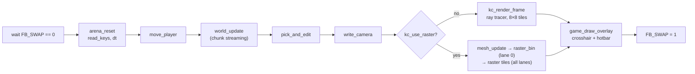

# KennyCraft game: the engine that runs on the TPU

Plain, freestanding C that builds from the **same files** for two platforms:

- **Laptop** (`-DKC_HOST`). `host/` emulates the TPU memory map, so the game can be played, screenshotted and tested headlessly.
- **TPU** (`-DKC_CHIP`, `rv32i_zmmul`). This build has no libc, no division, no floats and no libcalls. It talks to the TPU (Tai Processing Unit) SoC directly through its memory map and MMIO.

There are two renderers over one world. A per-pixel voxel **ray tracer** follows the VTRACE contract of the TPU's planned ray unit. A greedy-mesh **tile rasterizer** keeps its geometry in the TPU's 68 KB GPU memory. Both are written for the TPU's lane model: the same kernel runs on 1 lane today and on 8 SIMD lanes later.

## Quick start

```sh
make             # generate assets into gen/, build the laptop binary build/kc_host
make play        # scripted play-through: physics, place/break, chunk round trip (PASS/FAIL per check)
make shots       # golden camera shots  -> out/shots/*.png + *.fb
make compare     # ray tracer vs rasterizer on 5 poses -> out/cmp/, prints work counters
make bench       # DDA steps per frame at 160x120 and 320x240
make vectors     # VTRACE test vectors -> out/vectors/{world.hex,rays.txt}
make chip        # TPU ELF, 1 lane, ray tracer          -> build/kc_chip.elf
make chip8       # TPU ELF, 8 lanes, ray tracer + lane lint -> build/kc_chip8.elf
make chip-raster # TPU ELFs, 1 and 8 lanes, rasterizer  -> build/kc_chip{,8}_raster.elf
make atlas-edit  # copy gen/textures_atlas.png to assets/textures.png for hand editing
make clean       # remove build/ out/ gen/
```

The laptop binary always includes the rasterizer (`-DKC_RASTER=1`) and can switch renderers at runtime. Run it directly with `./build/kc_host shots|play|vectors|compare <dir>` or `./build/kc_host bench`.

### Toolchain

| Build | Needs |
| --- | --- |
| Laptop | A C11 compiler as `CC` (default `cc`; for example `make CC="zig cc"`), `python3` |
| TPU | `clang` with the riscv32 target (links with `ld.lld`), plus `llvm-objdump`, `llvm-size` and `llvm-nm` for the checks |

### Build switches

| Switch | Kind | Default | Effect |
| --- | --- | --- | --- |
| `KC_NO_STORAGE=1` | env var, read at runtime by `host/hal_host.c` | unset | The emulated DDR3 never calibrates, which exercises the no-storage fallback: `KC_NO_STORAGE=1 make play` |
| `KC_LANES` | C define | 1 | 1 (software mask) or 8 (custom-0 lane instructions). Set per target in the Makefile, so the environment does not override it. |
| `KC_RASTER` | C define | on for the laptop build and `chip-raster` | Compiles in the tile rasterizer |
| `KC_MAX_STEPS` | C define | 64 | DDA step cap. The ray tracer clamps it to 1..255. |
| `KC_WIDTH` | C define | 160 | Startup resolution: 160 (160×120, `FB_MODE` 1) or 320 (320×240, `FB_MODE` 0) |
| `KC_VTRACE` | C define | off | Use custom-1 `VSET`/`VTRACE`/`VGET` instead of the software DDA |
| `KC_NO_DDR` | C define | off | Skip DDR3 entirely and use the no-storage fallback |
| `KC_BUDGET_COUNT_FB` | C define | 0 | Count the two framebuffers inside the 192 KB budget |

The Makefile reads none of the C defines from the environment. To change one, add a `-D` flag to the compile.

## How a frame runs



`kc_main.c` owns this loop and, on the chip, `main()`. The rendering kernels follow two rules so that 8 lanes never diverge:

- **Per-pixel work is branch-free.** `sel()` in `fixed.h` contains an empty `asm` on purpose. Without it clang turns selects into branches, which would raise `ERR.DIVERGE` on 8 lanes. `make chip8` and `make chip-raster` run `tools/lane_lint.sh`, which fails if the kernel symbols contain per-lane branches.
- **Divergent work goes through masks.** Writes are gated by `LMASK`, and `BALLOT` provides uniform branches, for example to skip an 8-pixel group that no lane covers.

## Source map

| File | What |
| --- | --- |
| `src/kc_hal.h` | The only platform switch. On the chip it holds the TPU memory map, MMIO offsets, window geometry, texture index and shared-state structs. On the laptop it calls `host/hal_host.c`. |
| `src/kc_lanes.h` | `LANEID`/`LMASK`/`BALLOT`/`MASKGET`/`MASKSET`/`MASKALL`: software for 1 lane, custom-0 `.insn` for 8 |
| `src/fixed.[ch]` | Q16.16 math: `qmul`, `qrcp` (1/x from a table plus Newton, branch-free), `qsin` (1024 steps per turn), `sel()`, hashes |
| `src/trace.[ch]` | `ray_setup` and `kc_trace`, implementing the VTRACE contract. `vtrace_ref` is the C reference for one ray. |
| `src/render.[ch]` | Ray-tracing kernel: 8×8 tiles, one 4×2 pixel block per lane pass, pixel byte packing, sky gradient |
| `src/mesh.[ch]` | Greedy mesher into a pool of 1 KB pages |
| `src/raster.[ch]` | Tile rasterizer: back-face cull, clip, bin into 16×16 tile command lists, edge-function raster with depth |
| `src/kc_budget.h` | Compile-time 192 KB budget for rendering and real-time state (raster builds) |
| `src/terrain.[ch]` | Deterministic terrain and trees from absolute coordinates and a seed |
| `src/chunks.[ch]` | World memory API: `world_update`/`world_get`/`world_set`, chunk load/store through the TPU chunk engine, `SLOT_VALID`, `WIN_ORIGIN`, 8 KB `generated` bitmap |
| `src/blocks.h` | 16 block types, 4 bits each |
| `src/game.[ch]` | Keys, physics, picking, place/break, camera, crosshair and hotbar |
| `src/kc_main.[ch]` | Frame loop, resolution and step settings, chip `main()` |
| `src/arena.[ch]` | 8 KB per-frame bump allocator (from Bennett's `bench/kc-bench` branch, unchanged) |
| `src/kc_libc.c` | `memcpy`/`memset` for the freestanding chip build |
| `host/` | `hal_host.c` emulates the memory map, window ring, chunk engine, double framebuffer, UART and `CYCLES`. Also a PNG writer and the headless front end `main_host.c`. |
| `chip/bench/` | Bennett's `kc.ld`, `crt0.S`, `gpu.h` and arena, copied from the `bench/kc-bench` branch. They link `make chip` and `make chip8`. |
| `chip/stub_kc.ld` | `kc.ld` plus a `GPUMEM` region at `0x7000_0000` for the rasterizer's `.gpumem` section. Only `make chip-raster` uses it. |
| `tools/gen_assets.py` | Generates `gen/textures.hex`, `gen/palette.hex`, `gen/kc_tables.h` (1/x and sine tables), `gen/kc_assets.h` and atlas PNGs. If `assets/textures.png` exists, it is used as the texture source. |
| `tools/chip_check.sh` | Fails a TPU ELF that contains `div`/`rem`, float instructions, libcalls, `ecall` or CSR access |
| `tools/lane_lint.sh` | Fails if `qrcp`, `ray_setup`, `kc_shade_pixel` or `shade_px` contain a branch. `vtrace_ref` may contain one: the `BALLOT` loop exit. |

## Ray tracer and the VTRACE contract

Each pixel casts one ray through a window-bounded DDA. `vtrace_ref` (`src/trace.c`) is the reference that the hardware ray unit must match:

- Ties pick x, then y, then z.
- The start cell is never tested.
- Every call takes at least 1 step.
- Leaving the window or hitting the step cap gives `hit = 0` and `type = 0`. Steps, cell and `t` still report the last step.
- Face sign = step sign of the face axis.

Pixel byte = `color << 4 | shade << 2 | fog`. Color 15 is the sky: a 16-row gradient selected by `sky_k`.

## Tile rasterizer (`KC_RASTER=1`)

1. **Mesh** (only when chunks change). Greedy meshing turns each chunk into quads, written to a pool of 52 × 1 KB pages with 113 quads per page and chained per chunk. A quad stores 4 chunk-local `uint16` vertices (x 5 bits, y 6, z 5) and 1 material byte. Every quad uses the same shared index buffer `{0,1,2,0,2,3}`, drawn with base vertex = quad × 4. Moving the window never remeshes, because vertices are chunk-local.
2. **Bin** (lane 0):
   - Cull back faces from the face direction alone, without transforming anything.
   - Transform each remaining quad and clip it against the near, left, right, bottom and top planes.
   - Append the quad to the command list of every 16×16 tile it touches.
3. **Tiles** (all lanes). For each tile:
   - Clear a 1 KB buffer (2-byte color + 2-byte depth).
   - Rasterize the tile's quads with edge functions, using perspective-correct texturing and a depth test.
   - Write each pixel to the framebuffer exactly once.

Each edge grows by `EDGE_GROW` = 2 subpixels (1/8 px). This closes the hairline T-junction cracks that greedy meshing creates. Depth is stored as `z >> 6` in 16 bits, so it saturates about 64 blocks out.

## World and chunk storage

- The world is 4096 × 32 × 4096 blocks, split into 256 × 256 chunks of 16 × 32 × 16 (4 KB each in DDR3).
- The window is 4 × 4 chunks (64 × 32 × 64 blocks) at `0x2000_0000`. It is a ring addressed through `WIN_ORIGIN`, and `SLOT_VALID` marks the loaded slots. The window corner keeps the player 24–40 blocks from every edge.
- **With DDR3** (`DDR_STATUS` bit 0 set within 2 s): a chunk that has been generated is written out with `CHUNK_CMD` STORE when it leaves the window and LOADed when it returns. Chunks that were never generated are made from the seed, so storage never needs initializing.
- **Without DDR3** (`KC_NO_DDR`, or no calibration): load and store are no-ops and chunks are regenerated, so **edits are lost when their chunk leaves the window**. `make play` checks both paths ("fallback: chunk regenerated, edit gone").
- At most one chunk is generated per frame after startup.

## TPU interface

What the game expects from the TPU, beyond the shared memory map in `src/kc_hal.h`:

- **Camera block** at `0x1000_0000`, 48 B, Q16.16: absolute `origin`, `forward`, `right_step`, `up_step`.
- **`kc_rparams`** at `0x1000_0030`, 64 B, ending at `0x1000_0070`. Fields: `width`, `height`, `max_steps`, `sky_k`, `fog_d[3]`, `right[3]`, `up[3]`, `focal`, `corner_x`, `corner_z`. The game sets it, and only kernels read it. They take the committed window corner from `corner_x`/`corner_z`.
- **`gen/textures.hex`**: 12,288 lines, **one byte per line**. Index is `((type*3+face)<<8)|(v<<4)|u`, with face 0 top / 1 side / 2 bottom. Values 0–14.
- **`gen/palette.hex`**: 256 lines, **3 hex digits** RGB444 (11:8 R, 7:4 G, 3:0 B). Palette convention (no interface change): color index 15 is the sky, and its 16 entries form a top-to-bottom gradient instead of shade/fog variants.
- **`out/vectors/rays.txt`**: 2,000 rays as `f0..f7 max_steps -> res cell t` (hex, from `vtrace_ref`). **`world.hex`** holds 131,072 window blocks, one per line, in `(y*64+z)*64+x` order with `WIN_ORIGIN` = 0.
- **`.fb` files** are the raw 320×240 back buffer (stride 320), for pixel-matching against simulation.
- **Chip ELFs.** `crt0.S` executes `MASKALL` and `LANEID`, then gives each lane its own 1 KB stack below `0x1000_8000`. The TPU runs this even at 1 lane. Chip builds rely on `-msmall-data-limit=0`, because `kc.ld` collects only `.bss*`.

## Memory

### TPU data memory (measured with `llvm-size` on the ELFs)

| ELF | `.text` (IMEM 32 KB) | `.rodata + .data + .bss` (DMEM) | `.gpumem` (`0x7000_0000`) |
| --- | --- | --- | --- |
| `kc_chip.elf` | 13,156 B | 18,794 B | — |
| `kc_chip8.elf` | 13,124 B | 18,790 B | — |
| `kc_chip_raster.elf` | 23,684 B | 21,488 B | 69,632 B (68 KB) |

`kc.ld` gives the program `0x1000_0100`–`0x1000_6000` of DMEM, and the lane stacks start at `0x1000_6000`. `.gpumem` exactly fills the TPU's 68 KB GPU memory region. Note that `stub_kc.ld` still declares that region as 256 KB.

### 192 KB rendering budget (`src/kc_budget.h`, checked at compile time)

| Buffer | Size |
| --- | --- |
| World window, 1 copy, 4 bits per block | 64.0 KB |
| Textures (1 byte per texel) + palette | 12.5 KB |
| Mesh pool, 52 × 1 KB pages | 52.0 KB |
| Command lists: 1,024 visible quads + 4,096 tile entries | 17.2 KB |
| Tile buffer 16×16 × (2 B color + 2 B depth) | 1.0 KB |
| Mesher scratch | 1.8 KB |
| Chunk tables (stored-chunk set, edit-log allowance, slots) | 3.3 KB |
| **Total** | **151.8 KB of 192** |
| + two 160×120 framebuffers (`KC_BUDGET_COUNT_FB=1`) | 189.3 KB |

The budget leaves out two items: the 8 KB `generated` bitmap and the rest of the 8 KB frame arena. The chunk-table row reserves room for a 256-entry edit log that `chunks.c` does not implement. Chunk storage in DDR3 (up to 256 MB) is outside the budget.

Two choices made the mesh small enough:
- **Shared index buffer.** Every quad is two triangles in the same order, so a quad costs 9 bytes instead of 21.
- **1 KB pages.** A chunk wastes at most one partly filled page. `mesh.h` records 42 pages as the worst case over 60 sampled locations; at spawn the mesh uses 35.

No `malloc` anywhere. Every structure is a fixed-size static array, sized at compile time.

## Numbers

From `make bench` and `make compare` on this tree. Instruction counts are estimates: `main_host.c` multiplies host work counters by per-operation costs taken from the rv32 disassembly (52 instructions per DDA step).

| Golden shot (160×120) | Ray tracer (64 steps) | Rasterizer | Exact pixel match |
| --- | --- | --- | --- |
| spawn | 302 k steps, 19.5 M instr | 12.3 M instr | 77.8% |
| horizon | 532 k steps, 31.5 M | 11.7 M | 80.6% |
| looking down | 62 k steps, 7.1 M | 7.7 M | 89.0% |
| from higher up | 600 k steps, 35.1 M | 12.4 M | 78.3% |
| spawn at 320×240 | 1.21 M steps, 78.2 M | 43.3 M | 71.6% |

- The exact-match column compares whole pixel bytes, color, shade and fog bits included. The PNGs in `out/cmp/` show where the renderers differ.
- Peak rasterizer load in these shots is 469 visible quads and 1,571 tile entries (at 320×240), well under the 1,024 / 4,096 caps.
- With a 16-step cap, a 160×120 frame takes 207 k DDA steps, about 11 M instructions for the DDA alone. At 4+ CPI on the 50 MHz TPU core that is roughly 1 fps.

## Credits

The tile rasterizer follows Josh's design. `arena`, `kc.ld`, `crt0.S` and `gpu.h` come from Bennett's `bench/kc-bench` branch.
